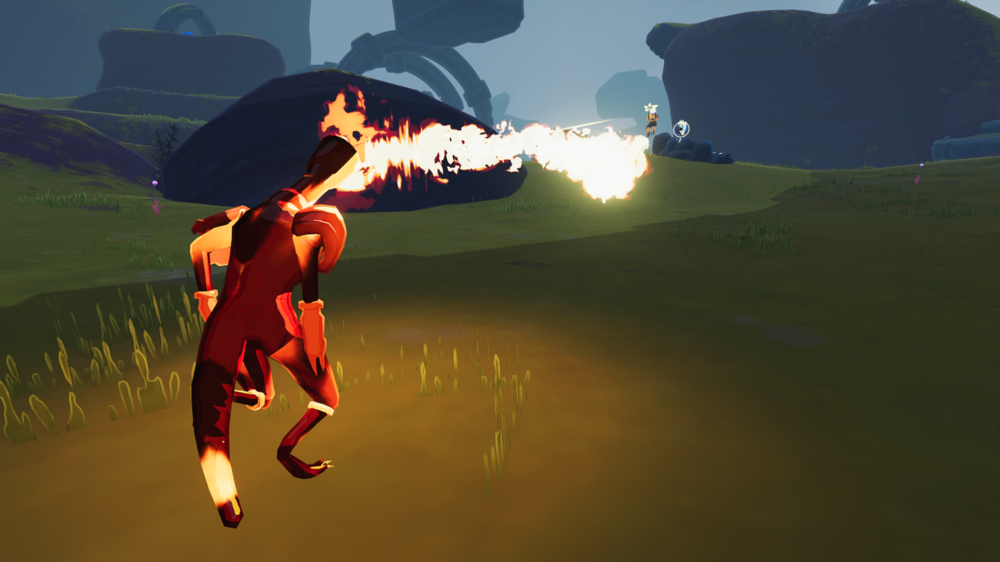
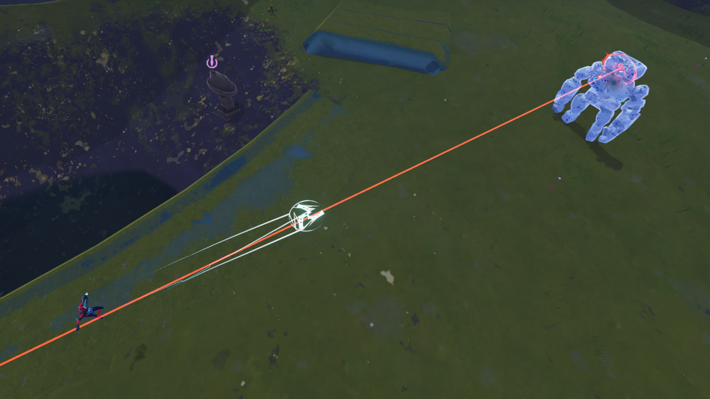
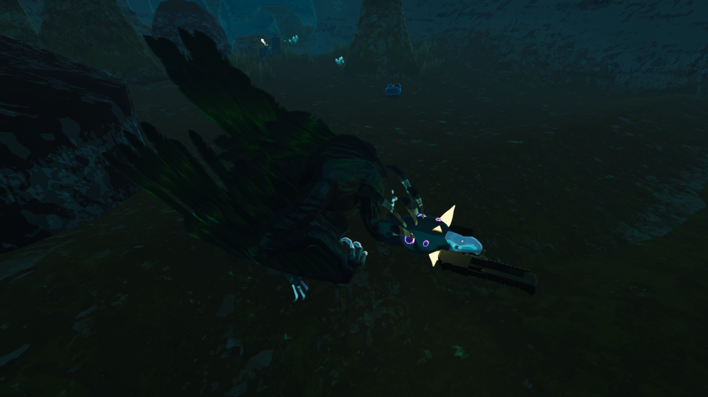
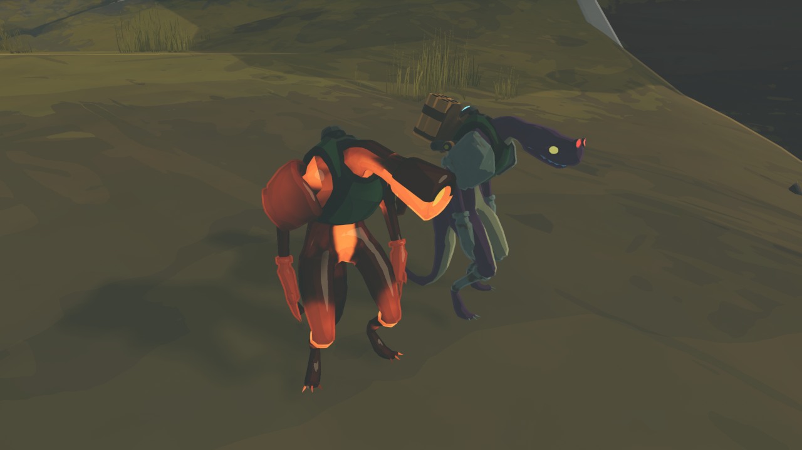
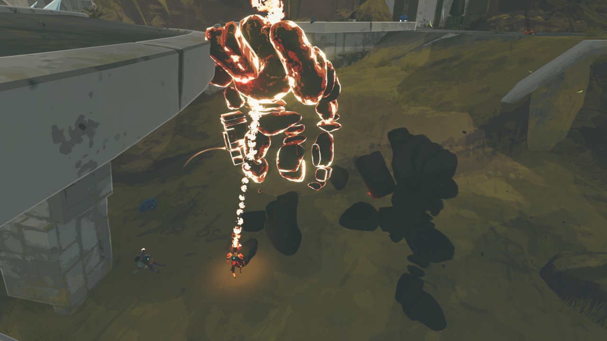

# Variant Pack - The Original 30

The Original 30 is a port of Rob's original variants from the [MonsterVariants](https://thunderstore.io/package/rob/MonsterVariants/) mods. Adds a total of 30 unique variants to the base game cast.

I've tried to keep their original essence intact, these are almost one to one recreations of their original behaviours back in the day.

## Variant Tablesheet

(Click me!)

| Character | Variant Name | Details |
|--|--|--|
| Beetle | Armored Beetle | A slower beetle with increased Health and Armor |
| Beetle | Battle Beetle | A Beetle with a high knockback headbutt |
| Beetle | Speedy Beetle | A Beetle with Increased movement and attack speed |
| Beetle | Toxic Beetle | A Beetle that self detonates into a poisonous explosion |
| Beetle Guard | Beetle Guard Brute | Increased Armor and Damage, reduced movement speed |
| Beetle Guard | Beetle Guard Sharpshooter | Highly increased attack speed and rock wave stocks |
| Bighorn Bison | Albino Bison | A Bison with increased health and damage |
| Bighorn Bison | Speedy Bison | A Bison with highly increased movement speed |
| Clay Templar | Fucking Templar | Increased movement and Atack speed |
| Elder Lemurian | Molten Elder Lemurian | Decreased Movement Speed and Attack Speed, Increased Damage, Armor and Health |
| Stone Golem | Full Auto Golem | Greatly Increased attack speed and laser beam stocks |
| Stone Golem | Overcharged Golem | Greatly increased damage and movement speed,  reduced armor and attack speed |
| Stone Golem | Rush Golem | Teleports instead of clapping |
| Stone Golem | Titanish Golem | Massively increased damage and health, reduced movement and attack speed |
| Greater Wisp | Greatest Wisp | Increased health, movement speed and attack speed |
| Imp | Clotted Imp | Reduced health, increased Crit, Teleports and has a Shatterspleen  |
| Jellyfish | Cursed Jellyfish | Reduced health, increased damage, has RedWhips, Crowbars and Runald band |
| Jellyfish | MOAJ | Greatly increased health, increased armor and damage, spawns 5 jellifishes on death |
| Jellyfish | Nuclear Jellyfish | Reduced movement speed, bigger nova radius and inflicts Weakness |
| Jellyfish | Spectral Jellyfish | Spawns a random lesser variant on death |
| Lemurian | Badass Lemurian | Has a Rocket Launcher |
| Lemurian | Flamethrower Lemurian | Fireballs replaced by a constant, long range Flamethrower, Cannot bite |
| Lesser Wisp | Almost Greater Wisp | Increased health, fires Greater Wisp Fireballs |
| Lesser Wisp | Infernal Wisp | Reduced Attack and Movement speed,  guaranteed crit alongside explosive attacks|
| Scavenger | Dream Scavenger | Always pulls out red items |
| Stone Titan | Enormous Titan | Greatly increased health, size and damage, reduced movement speed |
| Stone Titan | Pygmy Stone Titan | Greatly reduced size, greatly increased movement speed |
| Alloy Vulture | Alloy Deagle | Fires bullets |
| Alloy Vulture | Artillery Vulture | Explosive attacks, chance to fire a missile |
| Wandering Vagrant | Unstable Vagrant | Can use Vagrant Nova at any point in time |

### Donations

If you like what i do, and wish to help me out, consider donating on my Ko-fi

## Special Thanks

* Thanks to Rob for designing all of these variants.
* Thanks to PapaZach for designing the VariantPack's icon.

